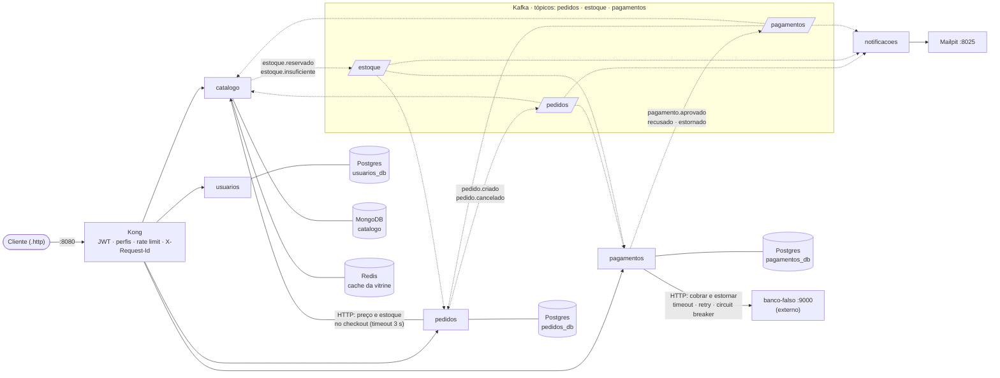

# E-commerce em microserviços

Dupla: **Jessika Rodrigues** e **Vitório Nicola**
Disciplina: Arquitetura de Sistemas (G2), Prof. Augusto Gehrke

Neste projeto, a loja foi organizada em cinco serviços, cada um com seu próprio banco de dados, e todas as requisições passam pelo Kong. A compra funciona como uma **saga**, com eventos no Kafka: o pedido é criado, o estoque é reservado e o pagamento é feito por um banco externo simulado. Se alguma etapa falhar, os serviços executam as ações necessárias para compensar o que já foi feito.

## Subir

Para iniciar o projeto em um clone novo, basta executar o comando abaixo. Não é necessário criar um `.env` nem configurar nada manualmente:

```bash
docker compose up -d --build
docker compose ps        # espere todos ficarem (healthy): leva 1 a 2 minutos na primeira vez
```

As migrações, os dados iniciais (seeds) e os tópicos do Kafka são criados automaticamente. Você também pode executar o comando novamente sem duplicar esses dados. Se quiser apagar tudo e começar do zero, use:

```bash
docker compose down -v && docker compose up -d --build
```

O arquivo `.env` é **opcional**, porque o `docker-compose.yml` já traz valores padrão para desenvolvimento. Se precisar alterar algum deles, copie o arquivo de exemplo com `cp .env.example .env`.

### Portas

| Porta | O quê |
|---|---|
| **8080** | **a API da loja (Kong)**: a única porta que o cliente usa |
| 8001 · 8002 | Admin API e painel do Kong (só na própria máquina) |
| 9000 | banco-falso, o banco do cartão (sistema externo, fora do Kong) |
| 8025 | Mailpit: os e-mails enviados (só na própria máquina) |
| 8090 | Kafka UI: tópicos e mensagens (só na própria máquina) |

Os serviços e bancos de dados não expõem portas para o host. O acesso a eles é feito pela rede interna, através do Kong.

### Usuários do seed

| E-mail | Senha | Perfil |
|---|---|---|
| `admin@loja.com` | `admin123` | admin |
| `cliente@loja.com` | `cliente123` | cliente (com um endereço) |

Na inicialização, o catálogo recebe 3 categorias (celulares, roupas e livros) e 12 produtos. Cada categoria tem seus próprios atributos e os produtos já vêm com estoque.

### Testar em 2 minutos

Para testar, instale a extensão **REST Client** no VS Code e abra `http/fluxo-completo.http`. Execute as requisições na ordem, clicando em **Send Request**. O arquivo passa pelo login, pela vitrine, pelo carrinho e pelo checkout (202). Ao final, o pedido fica **PAGO** e o pagamento **APROVADO**. Também há exemplos de cartão recusado, cancelamento com estorno e tentativa de acesso de cliente a uma rota de admin.

| Arquivo | O que mostra |
|---|---|
| `http/fluxo-completo.http` | fluxo completo da saga, do login ao PAGO, incluindo os casos de erro |
| `http/demos.http` | banco instável (retry), banco fora (circuito abre), banco lento (timeout), **cache** (MISS, HIT, invalidação, Redis fora) e **health** (ok, degradado, fora do ar) |
| `http/usuarios.http` · `catalogo.http` · `pedidos.http` | cada serviço, rota por rota, com os 400, 401, 403, 404 e 409 |
| `http/fluxo-compra.http` | a saga em detalhe, com o estoque antes e depois de cada passo |

O login permite **10 tentativas por minuto por IP**. Se executar vários arquivos em sequência muito rápida, pode receber um erro 429. Nesse caso, aguarde um minuto antes de tentar novamente.

## Arquitetura



As setas contínuas representam chamadas HTTP síncronas. As setas tracejadas representam eventos enviados pelo Kafka.

| Serviço | Banco | Responsabilidade |
|---|---|---|
| **usuarios** | Postgres (`usuarios`, `enderecos`) | cadastro, login, emite o JWT (único que emite), endereços |
| **catalogo** | MongoDB (`produtos`, `categorias`, `reservas`) + Redis (cache) | vitrine, gestão de produtos, **reserva e devolve estoque** |
| **pedidos** | Postgres (`carrinho_itens`, `pedidos`, `itens_pedido`) | carrinho, checkout, status do pedido, cancelamento |
| **pagamentos** | Postgres (`pagamentos`) | **cobra e estorna** no banco do cartão, com resiliência |
| **notificacoes** | SQLite local (e-mails já enviados, para não repetir) | e-mails no Mailpit; sem rota no Kong |
| **banco-falso** | memória | o banco do cartão (sistema externo): cobranças, recusa do cartão 0002, falhas simuladas |
| gateway (Kong) | sem banco (`kong/kong.yml`) | a porta: rotas, JWT, perfis, rate limit, X-Request-Id |
| Kafka (KRaft) + Kafka UI | — | os eventos da saga |

## Responsabilidade do gateway e dos serviços

**Gateway:** verifica a identidade do usuário (401) e se ele tem perfil para acessar uma rota de admin (403).
**Serviço:** verifica se o pedido ou endereço pertence ao usuário (404) e se o pedido ainda pode ser cancelado (409).

Quando uma requisição chega ao Kong, ela passa pelas seguintes etapas:

1. `correlation-id` dá um `X-Request-Id` (e devolve ao cliente).
2. `pre-function` apaga os `X-User-*` que vieram de fora: ninguém escolhe quem é.
3. A rota é escolhida pelo método e caminho. Rota que não existe: 404 do próprio Kong.
4. `jwt` valida o token e acha o consumer pelo campo `perfil`. Inválido ou ausente: 401.
5. `acl` confere o grupo nas rotas de admin. Perfil cliente: 403.
6. `post-function` copia `sub`, `email` e `perfil` do token para `X-User-Id`, `X-User-Email` e `X-User-Role`.
7. O Kong encaminha para o serviço, que só lê os cabeçalhos.


## Rotas

### usuarios

| Método | Rota | Acesso | No Kong |
|---|---|---|---|
| POST | `/auth/login` | público | rate-limiting 10/min por IP (429 na 11ª) |
| POST | `/usuarios` | público | — |
| GET · PUT | `/usuarios/me` | logado | jwt (401) |
| GET · POST | `/usuarios/me/enderecos` | logado | jwt (401) |
| DELETE | `/usuarios/me/enderecos/:id` | logado | jwt (401) · 404 se não é seu |
| GET | `/usuarios` | admin | jwt + acl (401 · 403) |
| GET | `/health/usuarios` | público | 200 ok · 503 fora do ar |

### catalogo

| Método | Rota | Acesso | No Kong |
|---|---|---|---|
| GET | `/produtos?categoria=&busca=` | público | — (com cache: `X-Cache`) |
| GET | `/produtos?ids=a,b,c` | público | — (o checkout do pedidos; nunca do cache) |
| GET | `/produtos/:id` | público | — (com cache: `X-Cache`) |
| GET | `/categorias` | público | — (com cache: `X-Cache`) |
| POST | `/produtos` | admin | jwt + acl (401 · 403) |
| PUT | `/produtos/:id` | admin | jwt + acl (401 · 403) · não muda o estoque (só o PATCH e a saga) |
| PATCH | `/produtos/:id/estoque` | admin | jwt + acl (401 · 403) |
| DELETE | `/produtos/:id` | admin | jwt + acl (401 · 403) |
| POST | `/categorias` | admin | jwt + acl (401 · 403) |
| GET | `/health/catalogo` | público | 200 ok ou degradado (Redis fora) · 503 fora do ar |

### pedidos

| Método | Rota | Acesso | Retornos |
|---|---|---|---|
| GET | `/carrinho` | logado | 200 `{ itens, total }` com preços atuais do catálogo |
| POST | `/carrinho/itens` | logado | 201 · 400 quantidade inválida · 404 produto não existe · 503 catálogo fora |
| DELETE | `/carrinho/itens/:produtoId` | logado | 204 · 404 não está no carrinho |
| POST | `/pedidos` | logado | 202 aceito · 400 carrinho vazio · 409 produto indisponível · 503 catálogo fora |
| GET | `/pedidos` | logado | 200 meus pedidos |
| GET | `/pedidos/:id` | logado | 200 com itens, status e motivo do cancelamento · 404 não existe ou não é meu |
| POST | `/pedidos/:id/cancelar` | logado | 200 cancelado (publica `pedido.cancelado`) · 409 status não permite (ex.: PAGO) |
| GET | `/health/pedidos` | público | 200 ok · 503 fora do ar |

Corpo do checkout:

```json
{
  "endereco_entrega": { "cep": "97000-000", "logradouro": "Rua Exemplo", "numero": "100", "cidade": "Santa Maria", "uf": "RS" },
  "forma_pagamento": "cartao",
  "numero_cartao": "4111 1111 1111 1234"
}
```

`forma_pagamento` pode ser `cartao`, `pix` ou `boleto`. Com cartão, só os 4 últimos dígitos são gravados. **Cartão terminado em 0002 é recusado** pelo banco-falso.

### pagamentos

| Método | Rota | Acesso | Retornos |
|---|---|---|---|
| GET | `/pagamentos/:pedidoId` | logado | 200 dono do pedido ou admin · 404 não existe ou é de outro cliente |
| GET | `/pagamentos?status=` | logado (o serviço exige admin) | 200 admin · 403 cliente |
| GET | `/health/pagamentos` | público | 200 ok ou degradado · 503 fora do ar (ver Observabilidade) |

### banco-falso (localhost:9000, fora do Kong)

| Método | Rota | Resposta |
|---|---|---|
| POST | `/cobrancas` `{ valor, cartaoFinal, referencia }` | 201 `{ aprovado, codigo: "TX-..." }` · 402 `{ motivo: "saldo insuficiente" }` com cartão 0002 · 503 com `falhaPercent` |
| POST | `/estornos` `{ codigo, referencia }` | 201 · 404 sem cobrança |
| GET · POST | `/config` `{ latenciaMs, falhaPercent }` | ver e mudar latência e falhas ao vivo |

Todos os erros da API seguem o mesmo formato:

```json
{ "erro": "Produto indisponível.", "detalhes": ["Arquitetura Limpa: pedido 99, disponível 9"] }
```

## Eventos (Kafka)

Todos os eventos seguem o mesmo formato: `{ id, tipo, pedidoId, ocorridoEm, correlationId, dados }`. A mensagem usa o `pedidoId` como chave. Assim, os eventos de um mesmo pedido ficam na mesma partição e mantêm a ordem entre si.

| Evento | Tópico | Quem publica | Quem reage |
|---|---|---|---|
| `pedido.criado` | pedidos | pedidos (checkout) | catalogo reserva · notificacoes avisa |
| `estoque.reservado` | estoque | catalogo | pedidos → AGUARDANDO_PAGAMENTO · **pagamentos cobra** |
| `estoque.insuficiente` | estoque | catalogo | pedidos → CANCELADO · notificacoes avisa |
| **`pagamento.aprovado`** | pagamentos | pagamentos | pedidos → PAGO · catalogo confirma a reserva · notificacoes avisa |
| **`pagamento.recusado`** | pagamentos | pagamentos | pedidos → CANCELADO com o motivo · catalogo **devolve** o estoque · notificacoes avisa |
| **`pagamento.estornado`** | pagamentos | pagamentos | notificacoes avisa o cliente do estorno |
| **`pedido.cancelado`** | pedidos | pedidos (cliente cancela) | catalogo **devolve** o estoque · pagamentos **estorna** ou bloqueia a cobrança · notificacoes avisa |

Recusa do banco e banco fora do ar dão no mesmo evento, `pagamento.recusado`, com motivos diferentes (`saldo insuficiente` ou `banco indisponível (...)`). A saga compensa igual.

## A saga da compra

Como os dados estão em três bancos diferentes (Postgres de pedidos, MongoDB do catálogo e Postgres de pagamentos), não existe um único ROLLBACK que desfaça toda a compra. Cada serviço confirma sua etapa e, se algo falhar depois, executa uma **ação de compensação**. Esse modelo é uma saga por **coreografia**: os serviços não dependem de um controlador central; cada um publica e recebe eventos.

| Passo | Serviço | Compensação | Disparada por |
|---|---|---|---|
| Criar o pedido | pedidos | marcar CANCELADO com o motivo | `estoque.insuficiente`, `pagamento.recusado` |
| Reservar o estoque | catalogo | devolver o estoque | `pagamento.recusado`, `pedido.cancelado` |
| Cobrar | pagamentos | estornar a cobrança | `pedido.cancelado` |
| Avisar o cliente | notificacoes | outro e-mail | qualquer cancelamento |

O estoque é reservado **antes** da cobrança. Se a compra não der certo, devolver o estoque é uma atualização no nosso banco; já o estorno pode gerar custo e aparecer no extrato do cliente. Por isso, se não houver estoque, o banco de cartão nem chega a ser chamado.

### O pedido, do começo ao fim

```
AGUARDANDO_ESTOQUE --estoque.reservado--> AGUARDANDO_PAGAMENTO --pagamento.aprovado--> PAGO
        |                                          |
        +--estoque.insuficiente / pagamento.recusado / cliente cancela--> CANCELADO (com motivo)
```

Mudança só a partir do estado esperado: PAGO só de um AGUARDANDO (de AGUARDANDO_ESTOQUE também, porque os tópicos `estoque` e `pagamentos` não têm ordem garantida entre si). Um pedido CANCELADO nunca volta a PAGO porque o banco aprovou atrasado. Cancelar um pedido PAGO devolve 409.

### O pagamento

| Status | Quando |
|---|---|
| PENDENTE | gravado antes de chamar o banco (`pedido_id UNIQUE`: o mesmo evento não cobra duas vezes) |
| APROVADO / RECUSADO | o banco respondeu |
| ERRO | o banco não respondeu (timeout, 503, circuito aberto); publica `pagamento.recusado` |
| CANCELADO | o pedido foi cancelado antes da cobrança: a linha ocupa o `pedido_id` e bloqueia a cobrança futura |
| ESTORNADO | cobrado e devolvido |
| ESTORNO_PENDENTE | o estorno falhou: fica gravado e é tentado de novo a cada 30 s (compensação não pode sumir) |

Se o cliente cancelar enquanto a cobrança estiver em andamento, o serviço de pagamentos registra `cancelamento_solicitado`. Quando o banco responder, o sistema faz o estorno caso a cobrança tenha sido aprovada. Nesse cenário, os status finais podem ser CANCELADO ou ESTORNADO, mas em ambos o cliente não fica pagando por um pedido cancelado.

Os campos `tentativas` e `motivo` ficam registrados. Assim, é possível consultar por que um pedido foi cancelado sem precisar abrir os logs.

## Resiliência na chamada ao banco (pagamentos → banco-falso)

| Padrão | Como | Onde |
|---|---|---|
| Timeout | `AbortSignal.timeout(2000)` em toda chamada | `pagamentos/src/banco.js` |
| Retry | até 3 tentativas, esperando 500 ms e 1 s (+ jitter); só timeout, erro de rede e 5xx. **402 não repete** | `banco.js` |
| Idempotência | `referencia` = id do pedido: o banco não cobra duas vezes a mesma referência, então o retry é seguro | banco-falso |
| Circuit breaker | **opossum**: abre com 50% de falha em pelo menos 5 chamadas, espera 15 s, testa no meio-aberto | `banco.js` |
| Estorno de segurança | timeout não é "não cobrou": desistiu sem saber, pede o estorno da referência (404 = não havia cobrança) | `eventos.js` |
| Fallback | esgotou as tentativas ou circuito aberto: status ERRO e `pagamento.recusado` (o pedido não fica parado) | `eventos.js` |

O estorno **não passa** pelo circuit breaker: devolver dinheiro é importante demais para ser barrado.

O retry fica em uma única camada, próxima do serviço que pode falhar: pagamentos → banco. A chamada de pedidos para catálogo não faz retry, porque acontece durante o checkout. Nesse caso, o sistema prefere retornar 503 rapidamente em vez de deixar o cliente esperando.

### Como demonstrar o circuit breaker

```bash
curl -X POST localhost:9000/config -H "Content-Type: application/json" -d '{"falhaPercent":100}'
# faça 2 ou 3 compras pelo http/fluxo-compra.http
docker compose logs pagamentos | grep -E "tentativa|CIRCUITO"   # tentativas falhando e "CIRCUITO ABERTO"
curl localhost:8080/health/pagamentos                           # "status": "degradado", "circuitoBancoCartao": "ABERTO"
curl -X POST localhost:9000/config -H "Content-Type: application/json" -d '{"falhaPercent":0}'
# depois de 15 s, a próxima compra testa (meio-aberto) e o circuito volta a "FECHADO"
```

Os mesmos passos estão prontos no `http/demos.http`.

Os logs registram cada tentativa, a abertura e o fechamento do circuito, os estornos e as compensações. Todas essas informações incluem o `pedidoId` e o `correlationId`:

```bash
docker compose logs pagamentos catalogo pedidos | grep <pedidoId>
```

## Demonstração do projeto

Tudo abaixo está pronto em `http/fluxo-completo.http` e `http/demos.http`.

| O quê | Como | O que se vê |
|---|---|---|
| **Saga feliz** | checkout com pix | pedido AGUARDANDO_ESTOQUE → AGUARDANDO_PAGAMENTO → **PAGO**; pagamento APROVADO; e-mail "Pagamento aprovado" no Mailpit |
| **Recusa** | cartão final **0002** | pedido **CANCELADO** ("pagamento recusado: saldo insuficiente"); estoque de volta; pagamento RECUSADO com 1 tentativa |
| **Cancelamento com estorno** | banco com `latenciaMs` 1900, checkout com cartão e cancelar logo em seguida | pedido CANCELADO; pagamento **ESTORNADO** (ou CANCELADO, se o cancelamento chegou antes da cobrança); estoque de volta; e-mail "Estorno realizado" |
| **Circuit breaker** | `POST localhost:9000/config {"falhaPercent":100}` e duas compras | 3 tentativas por compra; log `CIRCUITO ABERTO`; `/health/pagamentos` **degradado** com `circuitoBancoCartao: ABERTO`; a 3ª compra falha na hora, sem chamar o banco |
| **Cache** | `GET /produtos` duas vezes; admin muda um preço | `X-Cache: MISS` e depois `HIT`; depois da mudança, `MISS` com o preço novo |
| **Redis fora** | `docker compose stop redis` | a vitrine responde (`X-Cache: OFF`); `/health/catalogo` **degradado** |
| **Banco fora** | `docker compose stop pagamentos-db` | `/health/pagamentos` **503**; em ~30 s, `docker compose ps` mostra (unhealthy) |

## Observabilidade

### Health

Todo serviço responde `GET /health` (pelo Kong: `GET /health/<servico>`, sem token):

```json
{ "servico": "pagamentos", "status": "degradado",
  "dependencias": { "banco": "ok", "kafka": "ok", "circuitoBancoCartao": "ABERTO" } }
```

| status | Quando | HTTP |
|---|---|---|
| `ok` | tudo funcionando | 200 |
| `degradado` | funciona, mas pior: Redis fora (catálogo) ou circuito do banco do cartão aberto (pagamentos) | 200 |
| `fora do ar` | falta uma dependência essencial: o próprio banco ou o Kafka | 503 |

| Serviço | Dependências checadas |
|---|---|
| usuarios | banco |
| catalogo | banco (Mongo), kafka, cache (Redis) |
| pedidos | banco, kafka |
| pagamentos | banco, kafka, circuitoBancoCartao |
| notificacoes | banco (SQLite), kafka, smtp (Mailpit) |

O health verifica as dependências de verdade: executa `SELECT 1`, consulta o Kafka e faz PING no Redis, com limite de 2 segundos. Um serviço **não chama o health de outro serviço**. Assim, se o catálogo estiver fora, pedidos pode continuar funcionando, e a falha aparece como 503 no checkout.

No `docker-compose.yml`, todos os serviços têm `healthcheck`, que consulta `/health` com wget a cada 10 segundos e permite 3 tentativas. Quando tudo está funcionando, `docker compose ps` mostra os serviços como **(healthy)**. O Kong só inicia depois que os serviços ficam healthy (`depends_on: service_healthy`).

### Logs: uma compra, um id

O Kong dá um `X-Request-Id` a cada requisição (e devolve no cabeçalho da resposta). O pedidos copia esse id para o `correlationId` do evento, e cada serviço que recebe um evento passa o mesmo id adiante. Toda linha de evento (publicou, recebeu, compensou, tentativa, estorno) tem o `pedido=` e o `correlationId=`:

```bash
docker compose logs -t --no-log-prefix | grep <X-Request-Id> | sort
```

Esse comando permite acompanhar a compra passando por pedidos, catálogo, pagamentos e notificações. Senhas, tokens, número completo do cartão e e-mail do cliente não são registrados nos logs; no sistema, do cartão ficam apenas os quatro últimos dígitos. As chamadas de `/health` também não são registradas, porque o Docker as executa a cada 10 segundos e isso deixaria os logs cheios de informações repetidas.

## Cache da vitrine (Redis)

| | |
|---|---|
| Padrão | cache-aside: procura no Redis; não achou (MISS), busca no Mongo e guarda; achou (HIT), devolve sem ir ao Mongo |
| O que entra | `GET /produtos?categoria=&busca=`, `GET /produtos/:id`, `GET /categorias` |
| O que **nunca** entra | `GET /produtos?ids=` (o checkout precisa do preço e do estoque de agora), carrinho, pedidos, pagamentos |
| TTL | 60 s (+ até 10 s de variação, para as chaves não vencerem juntas) |
| Invalidação | por **versão**: toda escrita de produto ou categoria, e toda mudança de estoque (reserva, venda, devolução, ajuste do admin), faz `INCR catalogo:versao`. A versão faz parte do nome das chaves (`catalogo:v8:produtos:...`): as velhas ninguém mais procura e vencem pelo TTL |
| Cabeçalho | `X-Cache: HIT`, `MISS` ou `OFF` |
| Redis fora | `OFF`: a vitrine responde direto do Mongo, e o catálogo fica `degradado` (nunca fora do ar) |
| Avalanche | num MISS, só uma busca vai ao Mongo; as requisições iguais esperam o mesmo resultado |
| Redis | sem persistência (`--save ""`, `--appendonly no`): ao voltar, começa vazio, nunca com preço velho |

## Decisões (ADRs)

Cada decisão está documentada em um arquivo dentro de [`docs/adr/`](docs/). Os documentos explicam o contexto, a escolha feita e suas consequências, incluindo vantagens e limitações:

| ADR | Decisão |
|---|---|
| [001](docs/adr/001-um-banco-por-servico.md) | Um banco por serviço |
| [002](docs/adr/002-mongo-no-catalogo.md) | MongoDB no catálogo, Postgres no resto |
| [003](docs/adr/003-kong-declarativo-e-consumer-por-perfil.md) | Kong sem banco e um consumer por perfil |
| [004](docs/adr/004-servicos-confiam-nos-x-user.md) | Os serviços confiam nos cabeçalhos X-User-* |
| [005](docs/adr/005-saga-por-coreografia.md) | Saga por coreografia |
| [006](docs/adr/006-reservar-antes-de-cobrar.md) | Reservar o estoque antes de cobrar |
| [007](docs/adr/007-banco-fora-cancela-o-pedido.md) | Banco do cartão fora do ar cancela o pedido |
| [008](docs/adr/008-compensacao-que-falha-vira-estado.md) | Compensação que falha vira estado gravado |
| [009](docs/adr/009-cache-da-vitrine-com-versao.md) | Cache da vitrine no Redis, invalidado por versão |
| [010](docs/adr/010-health-com-tres-estados.md) | Health com três estados |

## Limitações conhecidas

- **Sem outbox no checkout.** O pedido é gravado e, depois do COMMIT, o `pedido.criado` é publicado. Se o Kafka falhar exatamente nesse instante, o checkout responde 503 ("pedido salvo, mas a publicação falhou") e o pedido fica em AGUARDANDO_ESTOQUE. O cancelamento e os resultados do pagamento já ficam gravados e são republicados; o checkout ainda não.
- **Sem DLQ.** Se um evento faz o handler falhar sempre (um "evento venenoso"), o kafkajs tenta de novo e o serviço reinicia, travando aquela partição. O certo seria mandar para um tópico de erros e reprocessar depois.
- **Invalidação grossa do cache.** Qualquer venda limpa a vitrine inteira (a versão é uma só). Com muito tráfego, seria melhor uma versão por categoria ou por produto.
- **Cache velho se o Redis cair durante uma escrita.** A invalidação falha e a vitrine pode mostrar o dado antigo por até 60 s (o TTL limita). O checkout nunca usa o cache, então ninguém paga o preço velho.
- **Cancelamento com estorno depende do tempo.** Só dá para cancelar antes do PAGO; para ver o estorno, o banco precisa estar lento (1,9 s) e o cancelamento chegar durante a cobrança. Os dois finais possíveis (ESTORNADO ou CANCELADO) estão certos.
- **Banco do cartão fora cancela o pedido** em vez de esperar ele voltar (ADR 007): perde a venda.
- **Um broker Kafka só**, com fator de replicação 1: se ele cair, os eventos param (os serviços ficam `fora do ar` no health).
- **banco-falso em memória**: reiniciá-lo apaga as cobranças, e um estorno depois disso responde 404.
- **Sem métricas nem traces de verdade** (Prometheus, Grafana, Jaeger): a observabilidade é health e logs com o correlationId. O Kafka UI não tem healthcheck (é só uma ferramenta de visualização).
- **Segredos de desenvolvimento no compose.** Os valores padrão (senha do Postgres, `JWT_SECRET`) servem para subir sem `.env`; em produção, viriam de um cofre de segredos.
- **Sem autenticação entre serviços** dentro da rede do Docker (ADR 004).

## Estrutura

```
E-commerce/
├── docker-compose.yml        # tudo: 5 serviços, 4 bancos, Redis, Kafka, Kong, Mailpit, banco-falso
├── .env.example              # opcional
├── README.md
├── docs/adr/                 # uma decisão por arquivo
├── kong/kong.yml             # rotas, consumers e plugins do gateway
├── usuarios/                 # Postgres · emite o JWT
├── catalogo/                 # Mongo + Redis · vitrine com cache, reservas e compensações do estoque
├── pedidos/                  # Postgres · carrinho, checkout, cancelamento
├── pagamentos/               # Postgres · cobrança com timeout, retry e circuit breaker
├── notificacoes/             # e-mails no Mailpit
├── banco-falso/              # o banco do cartão (externo), porta 9000
├── test/                     # testes pelo gateway
└── http/                     # fluxo-completo.http, demos.http e um por serviço
```

Para executar os testes automáticos sem iniciar o compose:

```bash
node --test pagamentos/test/banco.test.js   # timeout, retry, 402, estorno e circuito contra o banco-falso
node --test catalogo/test/cache.test.js     # MISS, HIT, invalidação, avalanche e Redis fora
node --test pedidos/test/regras.test.js usuarios/test/validacao.test.js
```

Com o compose no ar: `TEST_BASE_URL=http://localhost:8080 node --test test/gateway-pedidos.test.js`.

